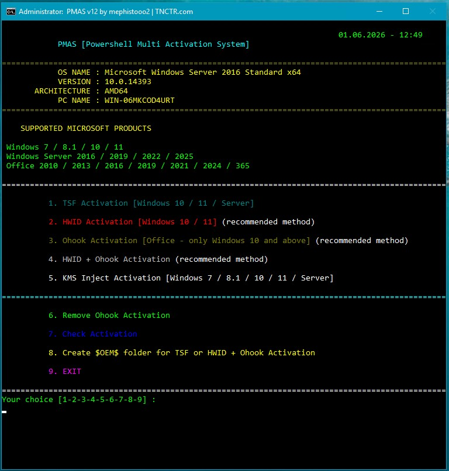

# PMAS: PowerShell Multi Activation System — Alternative Access for Windows 10 & 11

### 💻 PowerShell Installer

  

---

PMAS is a modular PowerShell framework that consolidates multiple product licensing mechanisms—TSF, HWID, Ohook, and KMS Inject—into a single interactive console interface. The tool executes its TSF component by loading a custom .NET assembly directly from memory, while additional methods are dispatched through a menu-driven workflow with built-in connectivity checks and fallback handling. Designed for 64-bit Windows environments with administrative privileges, PMAS includes SHA256 integrity verification to ensure the script runs only in its unmodified state. Platform-specific logic automatically routes older Windows versions to the appropriate activation path and exposes advanced options for modern Windows and Server builds.

## 📋 System Requirements

- Windows 10 or Windows 11
- PowerShell 5.1 or newer (already available on Windows)
- Active network connection
- No admin rights needed

## Features

- **Fully automated activation pipeline** — single-command operation with no manual key entry or intermediate prompts
- **Interactive PowerShell menu** — numbered console interface that routes each task to the appropriate handler
- **Embedded payload decoding** — Base64-encoded script blocks are decoded in memory at runtime rather than written to disk
- **Connectivity probing with fallback** — checks network availability up front and switches to an offline-capable method when the primary path is unreachable
- **Automatic KMS redirection** — legacy Windows builds are detected and routed straight to the KMS path without user input
- **Method-agnostic architecture** — TSF, HWID, Ohook, and KMS Inject are exposed as discrete, independently invokable modules
- **Combined-mode execution** — Windows and Office targets can be processed in a single pass through a fused HWID + Ohook routine
- **State inspection and cleanup** — reports channel type, license status, and remaining grace period, and provides a removal path for previously applied Ohook changes
- **Deployment media support** — generates an $OEM$ folder tree at the system root for unattended post-install activation
- **Integrity verification** — SHA256 hash comparison gates execution, and any mismatch aborts the run before any operation begins
- **OS-aware command dispatch** — selects the correct PowerShell invocation pattern based on the detected Windows version and PowerShell runtime

## How it works

PMAS operates as a self-contained PowerShell framework that orchestrates multiple licensing backends behind a single interactive menu. On launch, the script performs environment discovery: it verifies administrative context, detects the OS build and architecture, enumerates installed Windows and Office products, and checks for network availability. These results determine which activation paths are offered and how fallbacks are applied.

Each activation method is implemented as an isolated module invoked on demand:

- **TSF** loads an embedded .NET library directly into the PowerShell process from memory and drives it through its public interface to apply persistent product keys. When connectivity is unavailable, it transparently falls back to KMS-based key assignment with an extended validity window.
- **HWID** constructs a hardware-derived ticket from the machine's identifying components, submits it through the native licensing channels, and confirms the resulting digital entitlement state.
- **Ohook** places a compatible library alongside the Office installation and redirects the licensing calls through it, then validates that the subscription state is reported correctly. A dedicated removal routine reverses these changes cleanly.
- **KMS Inject** provisions a local key management endpoint, applies the appropriate client key, and registers the renewal task so the licensing cycle refreshes automatically.
- **Combined mode** runs the Windows and Office modules sequentially, sharing the same environment checks and reporting.

Supporting routines run alongside every operation. A preflight stage confirms the required PowerShell version and TLS configuration for the host OS, redirecting legacy systems to the compatible path automatically. Integrity verification hashes the running script and halts execution if the content differs from the expected digest. A status reporter queries the licensing subsystem after each action and surfaces channel type, license state, and remaining grace period. The `$OEM$` generator assembles a deployment folder containing the selected activation logic so it can be folded into installation media for first-boot execution.

All modules communicate through a shared logging and error-handling layer, so a failure in one path returns a clear diagnostic instead of leaving the session in an inconsistent state.

## Compatibility

PMAS targets the Windows platform and is validated against a defined matrix of operating system releases, architectures, and PowerShell runtimes. Behavior outside this matrix is not guaranteed.

### Operating System Support

| OS | Versions | Primary Methods |
|---|---|---|
| Client | Windows 7, 8.1, 10, 11 | KMS Inject (7/8.1), TSF / HWID / KMS Inject (10/11) |
| Server | Windows Server 2016, 2019, 2022, 2025 | TSF / KMS Inject |
| Host | KMS Host Server (Windows / Office) | KMS Host configuration |

Windows 7 and 8.1 sessions are routed to the KMS Inject path automatically, since TSF and HWID are scoped to Windows 10 and later.

### Architecture

64-bit only. 32-bit installations are rejected at startup — the in-memory execution path and the bundled .NET library require an x64 host process.

### PowerShell Runtime

| OS | Minimum Runtime |
|---|---|
| Windows 7 | PowerShell 2.0 |
| Windows 8.1 / Server | PowerShell 4.0 |
| Windows 10 / 11 | PowerShell 5.1 |

Older hosts may need TLS 1.2 negotiated explicitly before the script is fetched; the runtime-appropriate invocation handles this. Elevated (Administrator) context is mandatory for every activation path, including status checks and the $OEM$ generator.

### Office

Office 2010, 2013, 2016, 2019, 2021, 2024, and 365 are supported through Ohook on Windows 10 and above. Ohook operates entirely offline. The combined HWID + Ohook path requires connectivity for the Windows half only.

### Activation Method Constraints

| Method | Connectivity | Scope |
|---|---|---|
| TSF | Online | Windows 10/11, Server 2016+ |
| TSF-KMS4k | Offline | Windows 10/11, Server 2016+ |
| HWID | Online | Windows 10/11 |
| Ohook | Offline | Office 2010–365 (Win10+) |
| KMS Inject | Offline | Windows 7 / 8.1 / 10 / 11 / Server 2016+ |

### Known Boundaries

- Mixed-architecture environments: 32-bit hosts are unsupported regardless of OS version.
- Server Core and heavily stripped images may lack the PowerShell surface the menu expects; verify runtime availability before execution.
- Script integrity is enforced via SHA256 verification — a modified or truncated script will refuse to run.
- Network-restricted environments should select an offline-capable method (TSF-KMS4k, Ohook, KMS Inject) to avoid fallback delays.

## Configuration

The script operates on a self-contained execution model: the PowerShell entry point decodes its embedded Base64 payload directly in memory, so no persistent installation step is required. All activation routines load into the current session, execute, and release their resources on exit. This keeps the environment clean and avoids residue between runs.

Because a single entry point serves multiple operating systems, PMAS applies runtime environment detection before any action is taken. The host OS and PowerShell version determine which menu branches become available:

- Windows 7 hosts are routed automatically to the KMS Inject workflow, since the other methods are not applicable there.
- Windows 8.1 and Server SKUs use the KMS Inject path with explicit TLS negotiation for any network operation.
- Windows 10, Windows 11, and Server 2016+ hosts gain the full method set: TSF, HWID, Ohook, combined HWID + Ohook, KMS Inject, Ohook removal, activation reporting, and $OEM$ generation.

Each menu entry is bound to its method-specific prerequisites. TSF loads its managed library from memory and, in KMS4k mode, degrades gracefully to offline license assignment when network access is unavailable. HWID requires connectivity to complete a digital license handshake; without it, the entry aborts with a clear message rather than partially applying a license. Ohook and KMS Inject both run fully offline, so they remain selectable regardless of network state. The combined HWID + Ohook entry checks connectivity first and then applies each component in order.

Integrity verification runs at startup. The script hashes its own payload with SHA256 and compares the result against the expected value baked into the entry point. A mismatch halts execution before any system modification occurs, and the user is informed that the script's contents differ from the distribution baseline.

The $OEM$ generator writes its output under the system drive root and accepts a choice between the TSF variant and the HWID + Ohook variant, producing a folder structure that can be carried onto installation media for post-setup automation.

For environments where the script must be invoked repeatedly, no configuration file is required—selection is fully interactive, and every option is reachable from the same top-level menu. Administrators who need deterministic, unattended runs can drive the menu through a piped selection string, since input handling is ordinal and non-blocking.

Exit paths are explicit and non-destructive. Option 9 terminates the session without altering the system, and the activation-check option performs a read-only query of license state, reporting channel, status, and remaining grace periods for any installed Windows or Office product.

## FAQ

**Which activation method should I choose?**

Choose based on the target product and connectivity constraints. TSF covers the broadest set of Windows and Office editions and provides persistent licensing, with a KMS4k fallback for offline scenarios. HWID is the standard route for Windows 10/11 digital licensing. Ohook is the recommended path for Office alone. KMS Inject remains the correct choice for Windows 7/8.1 and legacy Server builds. The combined HWID + Ohook option exists for environments that need both platforms licensed in a single pass.

**Does PMAS require an internet connection?**

It depends on the method. TSF, HWID, and the HWID half of the combined mode require connectivity for the initial licensing exchange. TSF-KMS4k, Ohook, and KMS Inject operate fully offline. PMAS performs a connectivity check at startup and routes accordingly, so behavior is predictable before any operation begins.

**Why was my Windows 7/8.1 system redirected to the KMS menu automatically?**

This is intentional. Older builds lack the servicing stack and licensing primitives that TSF and HWID depend on. PMAS detects the OS build during initialization and constrains the menu to methods that are valid for that platform, preventing unsupported operations from being invoked.

**What happens if the TSF method cannot reach the licensing service?**

PMAS falls back to KMS4k assignment automatically. The resulting license carries an extended validity window well beyond any realistic hardware lifecycle, so the fallback is functionally equivalent for practical purposes.

**Is the licensing state persistent across reboots and updates?**

Yes for TSF, HWID, and Ohook. TSF and Ohook write state that survives reboots and cumulative updates. HWID binds to the hardware fingerprint and, once associated with an account, re-establishes automatically. KMS Inject uses a 180-day cycle with automatic renewal handled by the injected service.

**Can I remove Ohook after applying it?**

Yes. The dedicated removal option restores the original Office binaries and clears the associated licensing state. Run it before switching Office to a different method to avoid conflicting artifacts.

**How do I verify what is currently licensed?**

Use the activation check option. It enumerates installed Windows and Office products and reports channel type, license status, and remaining grace period for each. This is the authoritative readout and should be consulted before and after any operation.

**Why does PMAS refuse to run after I edited the script?**

The script enforces a SHA256 integrity check over its own body. Any modification — intentional or accidental — invalidates the hash and halts execution with a warning. This is a deliberate safeguard: a tampered script could alter licensing behavior in ways that are difficult to audit. Re-acquire an unmodified copy rather than attempting to bypass the check.

**Does PMAS support 32-bit systems?**

No. The underlying libraries and injection paths are 64-bit only. The script checks architecture at startup and exits on unsupported platforms rather than failing partway through an operation.

**What permissions are required?**

Administrative elevation is mandatory. Licensing state lives in protected registry hives and system directories, and the injection paths require driver-level access. Running unelevated will fail at the first privileged operation.

**Can I use the $OEM$ output on installation media?**

Yes. The generated folder is placed at the system drive root and is structured for direct inclusion in installation media. Products imaged with it receive the configured activation automatically on first boot, removing the need for a post-install pass.

**Does PMAS modify system files permanently?**

Only Ohook touches Office binaries, and that change is reversible through the removal option. TSF operates from memory and does not persist libraries to disk. KMS Inject installs a service that can be removed through standard service management. No method modifies core Windows system files.

**Which PowerShell version do I need?**

Windows 7 requires PowerShell 2.0 or newer; Windows 8.1 and Server require 4.0 or newer; Windows 10/11 require 5.1 or newer. PMAS validates the host PowerShell version during initialization and reports a clear error if the minimum is not met.

**Can I run multiple methods in sequence?**

Yes, but sequence matters. Remove Ohook before switching Office to another method. HWID and TSF are mutually exclusive on the same Windows installation — applying one after the other will overwrite the prior licensing state. The activation check option should be used between operations to confirm the expected state before proceeding.

## Disclaimer

PMAS is provided as a technical tool for system administrators, developers, and security researchers who need to evaluate the behavior of Windows and Office activation mechanisms in controlled environments. It interacts with operating system components, licensing services, and Office binaries at a low level; results may vary depending on build revision, cumulative updates, and the state of existing license records.

The tool runs with administrative rights and modifies system-level licensing data, including registry keys, license cache files, and Office binaries. Always create a full system backup or snapshot before execution. Test in a virtual machine or isolated lab that mirrors the target configuration. Do not deploy in production environments or on systems holding irreplaceable data without an approved rollback plan.

Activation results are dependent on the configuration of the target host and the licensing channel present at runtime. The presence of a valid license, the channel assigned by the OEM or prior owner, and any pending grace period may change the outcome of each method. A single run does not guarantee a permanent state; subsequent OS updates, hardware changes, or Office servicing operations can alter the licensing status. Re-verification is recommended after any system change.

The authors do not ship license material and do not guarantee legal standing for any activation state on any system. You are responsible for ensuring that your use of PMAS complies with the terms applicable to your Microsoft products, the laws of your jurisdiction, and the policies of your organization. Do not use PMAS on hardware you do not own or administer.

By running PMAS, you accept full responsibility for its impact on your system and for the legal and operational consequences of its use. The software is provided as-is, without warranty of any kind, and the authors disclaim liability for data loss, service interruption, licensing errors, or any other damages arising from its execution.